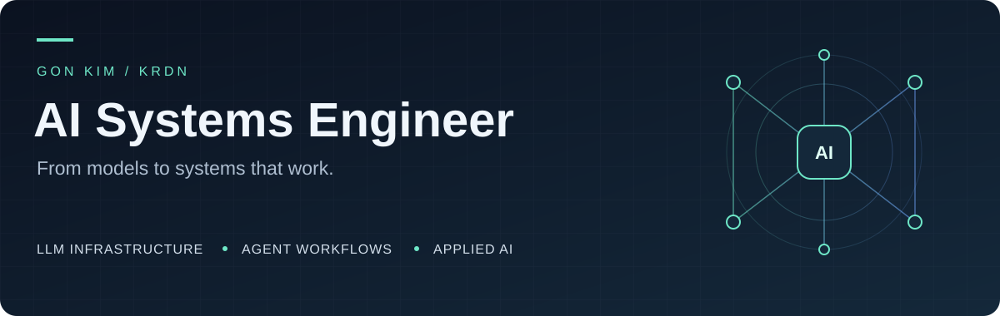

  

  <strong>모델을 연결하고, 에이전트의 작업을 설계하고, 결과를 검증합니다.</strong> 
  LLM 인프라부터 개발 자동화까지, AI를 실제 소프트웨어로 만드는 Gon Kim입니다.

  <a href="https://github.com/krdn/llm-gateway">LLM Gateway</a> ·
  <a href="https://github.com/krdn/gon-github-workflow">Agent Workflow</a> ·
  <a href="https://github.com/krdn?tab=repositories">All Repositories</a>

---

### 집중하는 영역

| LLM Infrastructure | Agent Engineering | Applied AI |
| :--- | :--- | :--- |
| 여러 모델을 하나의 인터페이스로 연결 | 계획·구현·검증·인수인계의 흐름 설계 | 도메인 데이터와 모델을 연결하는 분석 도구 |
| 구조화 출력, 재시도, 토큰 사용량 관리 | Claude·Codex 작업을 GitHub 기록으로 연결 | 스키마 검증과 근거를 갖춘 결과 구성 |

### 대표 프로젝트

<table>
<tr>
<td width="50%" valign="top">
<h3><a href="https://github.com/krdn/llm-gateway">01 / LLM Gateway</a></h3>

<strong>여러 모델, 하나의 인터페이스.</strong>

Anthropic·OpenAI·Gemini 등 여러 제공자를 연결하는 TypeScript 라이브러리. 구조화 출력, 재시도, 취소, 토큰 집계를 공통 계층에서 다룹니다.

<code>TypeScript</code> <code>Zod</code> <code>Multi-provider</code>

</td>
<td width="50%" valign="top">
<h3><a href="https://github.com/krdn/gon-github-workflow">02 / GitHub Workflow</a></h3>

<strong>에이전트 작업을 추적 가능한 개발 과정으로.</strong>

Claude·Codex의 계획, 디버깅, 검증, 인수인계를 GitHub 기록으로 연결하는 개인 개발 워크플로 도구입니다.

<code>Claude</code> <code>Codex</code> <code>GitHub</code>

</td>
</tr>
<tr>
<td width="50%" valign="top">
<h3><a href="https://github.com/krdn/gon-development-os">03 / Development OS</a></h3>

<strong>목표에서 검증·전달까지 이어지는 개발 표준.</strong>

앱·웹서비스·스킬·에이전트 프로젝트를 위한 매뉴얼과 재사용 스킬, 생성 도구, 검증 기록을 함께 관리합니다.

<code>Agent Skills</code> <code>Workflow Design</code>

</td>
<td width="50%" valign="top">
<h3><a href="https://github.com/krdn/tickerlens">04 / TickerLens</a></h3>

<strong>하나의 질문을 여러 분석 관점으로.</strong>

주식 데이터를 가치·성장·퀀트·옵션의 네 관점과 세 시간축으로 분석하는 LLM 응용 라이브러리. 결과를 Zod 스키마로 검증합니다.

<code>Applied LLM</code> <code>Structured Output</code>

</td>
</tr>
</table>

### 일하는 방식

- **명확한 계약** — 입력·출력 스키마와 책임 범위를 먼저 정합니다.
- **검증 가능한 결과** — 구현 완료, 테스트 통과, 실제 동작을 구분합니다.
- **이어갈 수 있는 작업** — 결정과 근거를 저장소에 남겨 다음 작업으로 연결합니다.

### 기술 기반

**AI & Agents** · Claude · Codex · OpenAI · Gemini · MCP · n8n  
**Engineering** · TypeScript · Python · C# / .NET · Zod  
**Delivery** · GitHub Actions · Docker · Linux

---

  <strong>Build with intent. Verify with evidence.</strong> Seoul, South Korea · <a href="https://github.com/krdn">github.com/krdn</a>

